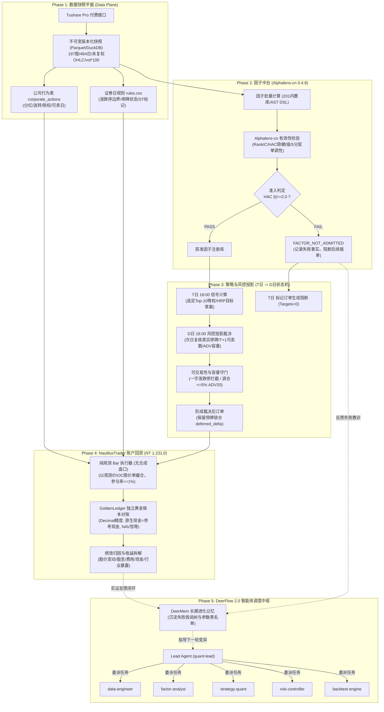
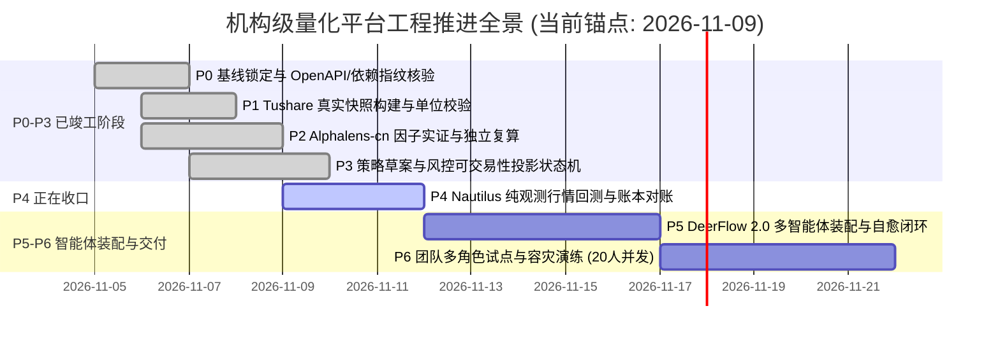

# 机构级 A 股量化投研平台框架设计 V1.1 (生产实证强化版)

> **版本**：v1.1.0-Institutional  
> **基准运行环境**：Windows x64 · Python 3.12 · NautilusTrader 1.231.0 · Alphalens-cn 0.4.8 · DeerFlow 2.0 Harness  
> **数据底座**：100% Tushare Pro 官方付费数据快照（指纹前缀 `4b139947`，197 标的 / 484 交易日 / 85,981 行，零模拟/零合成数据）  
> **核心仓库版本锁定**：  
> • `ashare-factor-research` (Commit: `6d883a4`)  
> • `ashare-factor-agent-gpt` (Commit: `d766643`)  
> • `ashare-nautilus-backtest-engine` (Commit: `b8d424d`)  
> • `ashare-strategy-portfolio` (Commit: `cddae3f`)  
> • `ashare-research-risk` (Commit: `11d10cd`)  
> • `deerflow-multi-agent-demo（skill版）` (SHA-256: `f0e1b11daa042425f7a2e71b3ff865bb3bd99e3351f4dd60b6e9fe7f5dc48186`)

---

## 目录
- [一、 战略定位与三大工作铁律](#一-战略定位与三大工作铁律)
- [二、 结合 P0-P4 实测的 6 大关键架构优化](#二-结合-p0-p4-实测的-6-大关键架构优化)
- [三、 既有核心资产与开源底座锁定矩阵](#三-既有核心资产与开源底座锁定矩阵)
- [四、 全景核心架构与跨阶段时序状态机](#四-全景核心架构与跨阶段时序状态机)
- [五、 多智能体团队职责、Skill 规范与 Tools 定义表](#五-多智能体团队职责skill-规范与-tools-定义表)
- [六、 P0 - P6 全生命周期实施规划与技术栈细节](#六-p0---p6-全生命周期实施规划与技术栈细节)
- [七、 贴合实战的机构级严苛验收标准 (6 项硬指标)](#七-贴合实战的机构级严苛验收标准-6-项硬指标)
- [八、 下一步工程落地行动清单](#八-下一步工程落地行动清单)

---

## 一、 战略定位与三大工作铁律

面向 A 股机构级自研量化投研需求，打造贯穿**「数据治理 $\rightarrow$ 因子挖掘 $\rightarrow$ 策略合成 $\rightarrow$ 投研端风控 $\rightarrow$ 高保真事件驱动回测 $\rightarrow$ RD-Agent 自动化假说自进化」**的全流程平台。系统全面遵守三大工程铁律：

1. **100% 拒绝任何模拟/合成数据（Zero Synthetic Data）**：
   - 全面断绝所有本地 Mock 数据发生器。
   - 彻底废除 `synthetic_book` 等将 Bar 拆为未观测 L2 盘口的伪造逻辑。平台全生命周期只允许消费来自 **Tushare Pro 官方付费接口** 的真实历史与实时数据，包含真实的未复权 OHLC、每日官方涨跌停板（`stk_limit`）、停牌与 ST 标记、除权除息（`dividend`）以及 PIT（Point-in-Time）财报披露点阵。
2. **零重复造轮子（Zero Reinventing Wheel）**：
   - 充分吸收并整合既有高质量 GitHub 仓库与工业界验证过的顶尖开源项目，底层严禁重写成熟算法。
   - 所有外部依赖与自研组件严格锁定提交哈希（Commit SHA）与包指纹，通过 OpenAPI 和不可变快照解耦。
3. **以 DeerFlow 2.0 为多智能体组织中枢**：
   - 复用 `deerflow-multi-agent-demo（skill版）` 的成熟生产级 Harness 架构，通过**「子代理环境隔离 + 领域 Skill 延迟装载 + 确定性工程 Tools + 生产级防护中间件 + DeerMem 长期进化记忆」**，实现机构级投研自治闭环。

---

## 二、 结合 P0-P4 实测的 6 大关键架构优化

结合真实推进过程中的实证记录（特别是 P2 因子未达标、P3 风控投影、P4 盘口合成与零生成数据原则冲突），V1.1 进行了 6 项关键认知升级与重构：

| 优化维度 | V1.0 版本的理想化设想 (Gap) | 结合真实 P0-P4 实证后的关键优化 (V1.1 改进) |
| :--- | :--- | :--- |
| **1. 回测撮合与“零生成数据”原则的根本冲突** | V1.0 沿用了 `bar-synthetic-l2-v1` 概念，试图将日/分钟 Bar 拆解为高低排序的内部盘口深度进行撮合。 | **彻底剔除合成盘口（`synthetic_book`）**：在缺乏真实 L2 逐笔数据的现状下，任何将 Bar 拆为 OrderBook 的逻辑都违反了“不使用模拟生成数据”铁律。V1.1 明确采用**“纯观测 Bar 执行模型（Observed-Bar Execution Model）”**，基于可观测的开盘/收盘价与真实成交量参与率上限（$\le 1\%$）进行撮合，模型假设与观测数据严格分列。 |
| **2. 因子有效性与准入的“负向失败路径”** | V1.0 假设因子均能顺畅通过 HAC $t \ge 2.0$ 门禁流向策略和回测，属于“理想化正向流水线”。 | **建立完整的“不达标阻断与反思路由（Negative-Path Routing）”**：正如 P2 实测的 20 日动量因子因 IC 为负被判定为 `FACTOR_NOT_ADMITTED`，P3 策略层必须具备**“因子未准入 $\rightarrow$ 拦截生成实际报单 $\rightarrow$ 记录 `BLOCKED` 状态 $\rightarrow$ 触发 DeerMem 反思”**的完整防作弊阻断机制。 |
| **3. 时序推进与风控裁决的状态机精度** | V1.0 简单将风控描述为“回测前过滤”，将停牌处理为“权重清零”。 | **建立精确的 $T$ 日信号与 $D$ 日风控状态机**： • $T$ 日 18:00（信号生成）：基于 $T$ 日收盘可得信息生成目标草案； • $D$ 日 18:00（下一交易日风控复核）：结合 $D$ 日停牌、真实 T+1 可卖股数、ADV 容量进行裁决； • **停牌必须锁仓并计为 `deferred_delta`（延期调仓）**，严禁粗暴清零或伪造强平，真实记录暴露风险。 |
| **4. 人机协同（Human-in-the-Loop）与权限分界** | V1.0 设想由 Lead Agent 自主决定因子的入库与上线。 | **收回 Agent 的最终准入签发权**：`ashare-factor-research` 源码中严格保留了人类专用的 `freeze`、`final`、`admit` 权限。Lead Agent 可以自主做研发（Propose $\rightarrow$ Evaluate），但只有人类研究负责人持有最终准入私钥，确保审计合规。 |
| **5. 既有仓库的固定版本（Pinning SHA）与 OpenAPI 契约** | V1.0 工具层是概念性的抽象函数调用。 | **硬性锁定 Commit SHA 并对接已有 OpenAPI**：直接对接 Generator（`d766643`）、Research（`6d883a4`）与 Engine（`b8d424d`）的正式接口（如 `/api/integration/jobs`），禁止通过 Agent 在宿主机执行任意 shell 命令或动态脚本。 |
| **6. 独立黄金账本（Golden Ledger）与三方对账** | V1.0 仅提及“对账”。 | **将 `GoldenLedger` 提升为一票否决级硬门禁**：采用 Decimal 精度，原生现金、参考现金、持仓股数、应收股息与总 NAV 必须逐日绝对恒等（误差 $\equiv 0$），账不平直接熔断并停止签发任何回测报告。 |

---

## 三、 既有核心资产与开源底座锁定矩阵

平台彻底打通并直接驱动以下 5 大本地与 GitHub 仓库核心资产：

| 平台核心模块 | 依托核心项目 / 资产 | 锁定版本 / 取证依据 | 核心能力吸收与适配工作 |
| :--- | :--- | :--- | :--- |
| **数据基底** | **Tushare Pro 付费版** | 快照指纹 `4b139947` (197股/484日/85,981行) | **契约重铸**：Tushare `vol` 手强制乘以 100 转为“股”；提取 `ann_date` 实现严格 PIT 点阵对齐，防止财报未来函数。755 个缺收盘价证券日严格标记停牌/未上市。 |
| **因子中枢** | **`ashare-factor-research`** (含 `Alphalens-cn 0.4.8`) | Commit: `6d883a4` OpenAPI 规范 | • 内置 201 个因子定义（`stock_reference`, `qlib_alpha158`, `alpha101`）； • Alphalens-cn 因子有效性实证检验体系； • 将 `factor_research.cli` 封装为 Agent 工具；保留人类专属 `freeze/final/admit` 权限。 |
| **策略中枢** | **`ashare-strategy-portfolio`** | Commit: `cddae3f` | • 结构化经济假说库 (`strategy.hypotheses`)； • 统计正交贪心挑选器（$\|corr\| \le 0.35$ 拦截）； • HRP（层次风险平价）与 CVXPY 二次规划优化器； • 注入换手率线性惩罚项，并设定单票与行业持仓上限。 |
| **风控中枢** | **`ashare-research-risk`** | Commit: `11d10cd` | • ADV 流动性容量守门（单日调仓 $\le 5\% \text{ADV}_{20}$）； • Almgren-Chriss 平方根冲击成本估算； • 波动率目标化与 3 级阶梯净值熔断（8%/12%/15%）； • Barra CNE5/CNE6 风格与行业归因模型； • 投研端风控下沉：一字涨停禁买、一字跌停禁卖、停牌标的真实锁仓延期。 |
| **回测中枢** | **`ashare-nautilus-backtest-engine`** (NautilusTrader 1.231.0) | Commit: `b8d424d` Python 3.12 + Cython | • Rust 原生微秒级事件驱动回测内核； • 纯观测 Bar 执行器，废弃 `synthetic_book`； • 严格 A 股微观机制：T+1 冻结、MOO 开盘集合竞价撮合、卖出万五印花税、最低 5 元佣金； • 每日终态 `GoldenLedger` 黄金账本绝对无误差核对。 |
| **智能体中枢** | **`bytedance/deer-flow`** 2.0 (`deerflow-multi-agent-demo`) | SHA-256: `f0e1b11d...` (harness 2.3.0-dev) | • 替换电商周报业务，注入量化 5 大专员与技能； • 完整生产中间件链（脱敏审计、重试、熔断、输出预算）； • Skills 延迟发现与 DeerMem 长期记忆后端，闭环支撑 RD-Agent。 |

---

## 四、 全景核心架构与跨阶段时序状态机

系统按照**“数据快照 $\rightarrow$ 因子实证 $\rightarrow$ 策略草案 $\rightarrow$ 风控裁决 $\rightarrow$ 账户回放 $\rightarrow$ 黄金对账 $\rightarrow$ 智能体进化”**的单向数据流推进：

---

## 五、 多智能体团队职责、Skill 规范与 Tools 定义表

根据 `deerflow-multi-agent-demo` 规范，所有 Subagent 采用环境隔离运行，各 Agent 仅能访问其白名单内的工具与技能规范：

| 智能体角色 | 职责边界与权限 | 装载的 Skills 规约 | 配备的确定性 Tools (对应底层代码) |
| :--- | :--- | :--- | :--- |
| **Lead Agent** `quant-lead` | 统领全流程研究规划；将假说拆解为各专员可执行的 Subtask；记录研发预算；**无最终准入签发权（需人工审核）**。 | • `research-workflow-spec` • `institutional-review-standard` | • `dispatch_job(role, args)` • `get_job_status(job_id)` • `memory_search / memory_add` (DeerMem) • `assemble_evidence_report()` |
| **Data Agent** `data-engineer` | **唯一允许从环境读取凭据请求 Tushare Pro 的工作节点**；构建不可变快照；生成 `bars.csv`、`rules.csv`、`corporate_actions`。 | • `tushare-snapshot-spec` • `a-share-microstructure` | • `tushare_build_snapshot(universe, dates)` • `tushare_export_bars_and_rules()` • `tushare_align_corporate_actions()` |
| **Factor Agent** `factor-analyst` | 基于 `ashare-factor-research`（Commit `6d883a4`）计算因子；运行 **Alphalens-cn 0.4.8** 实证；输出未达标或准入报告。 | • `alphalens-cn-evaluation-spec` • `factor-causal-audit-spec` | • `compute_factor_batch(dataset_id, factor_list)` • `run_alphalens_evaluation(factor_id, periods)` • `register_factor_candidate(manifest)` |
| **Strategy Agent** `strategy-quant` | 依赖 `ashare-strategy-portfolio`（Commit `cddae3f`）；挑选获准低相关因子（$\|corr\| \le 0.35$）；运行 HRP 或等权生成 $T$ 日初始草案。 | • `strategy-hypothesis-spec` • `hrp-portfolio-optimization` | • `orthogonal_factor_select(approved_factors)` • `build_target_portfolio(strategy_type, top_n)` • `export_draft_targets(output_csv)` |
| **Risk Agent** `risk-controller` | 依赖 `ashare-research-risk`（Commit `11d10cd`）；$D$ 日风控投影；**停牌锁仓不平**；一字涨跌停拦截；单日调仓 $\le 5\% \text{ADV}_{20}$。 | • `tradability-capacity-spec` • `barra-cne6-risk-spec` | • `project_tradability(draft_targets, holding_state)` • `apply_adv_capacity_guard(adv_matrix, cap=0.05)` • `check_concentration_limits(single_stock, ind)` |
| **Backtest Agent** `backtest-engine` | 依赖 `ashare-nautilus-backtest-engine`（Commit `b8d424d`）；启动 NT 1.231.0 纯观察 Bar 回放；执行 `GoldenLedger` 黄金账本核算。 | • `nautilus-fidelity-spec` • `golden-ledger-reconciliation` | • `run_nautilus_observed_replay(bars, rules, orders)` • `reconcile_golden_ledger(events, cash_ledger)` • `export_pnl_attribution(attribution_csv)` |
| **Independent Reviewer** *(人类独立复核人)* | 拥有最高权限；核验数据完整性、试验独立性、过度拟合指标（DSR/PBO）；**唯一持有签发准入（Admit）密钥的角色**。 | • `independent-audit-spec` • `overfitting-governance` | • `audit_trials_matrix(study_id)` • `verify_signature_bundle(manifest_hash)` • `sign_formal_admission(pass_token)` |

---

## 六、 P0 - P6 全生命周期实施规划与技术栈细节

项目总计划分为 7 个阶段，**当前处于 P4 收尾与 P5 启动的交汇点**：

### 阶段执行与技术细节：

* **P0 基线锁定（已完成）**：
  - 锁定交付清单 Generator `d766643`、Research `6d883a4`、Engine `b8d424d`；
  - 校验 wheel 包 SHA-256 与 Cython `split_native` 指纹，完全杜绝版本漂移。
* **P1 真实数据湖（已完成）**：
  - Tushare Pro 付费快照（197 标的 / 484 交易日 / 85,981 行，指纹 `4b139947`）；
  - 确立成交量乘数 $= 100$（手转股），提取 755 个缺价日并标注停牌，排除财报披露未来函数。
* **P2 因子实证（已完成）**：
  - 调用 `ashare-factor-research` 运行 20 日动量因子，Alphalens-cn 独立复算差额 $< 5 \times 10^{-13}$；
  - 确认因 IC 为负被判定为 `FACTOR_NOT_ADMITTED`，建立真实失败留痕证据链。
* **P3 策略与风控投影（已完成）**：
  - 成功建立 $T$ 日信号到 $D$ 日次日风控的交易投影状态机；
  - 严格执行单票上限 10%、行业上限 30%、现金缓冲垫 5%、单日调仓 $\le 5\% \text{ADV}_{20}$；
  - 停牌股票锁仓不可卖，差额记为 `deferred_delta`，违规报单通过率为 0。
* **P4 高保真回测（当前收尾关键）**：
  - **核心动作**：明确关闭 `synthetic_book`，采用**纯观察 Bar 驱动模式**；
  - 运行真实的 85,981 行 Bar 数据输入 NT，执行 IOC 限价单并以 $1\%$ 真实成交量预算限制成交；
  - 驱动 `GoldenLedger` 进行原生现金与参考账本的 Decimal 级逐日核对，确保 NAV 恒等。
* **P5 DeerFlow 2.0 多智能体装配（即刻启动）**：
  - 复用 `deerflow_src` 的 Harness SDK 与中间件（`AuditLog`, `ToolOutputBudget` 等）；
  - 将 P0-P4 的代码封装为标准 Tools，挂载各专业 `SKILL.md`；
  - 基于 DeerMem 打通自动化假说演化与变异自愈。
* **P6 团队试点与容灾交付（最终验收）**：
  - 模拟 20 个研究员并发会话，支持 4 个并行作业提交与断线恢复；
  - 验证持久化数据库租约机制，达成 RPO $\le 24$h, RTO $\le 4$h 容灾标准。

---

## 七、 贴合实战的机构级严苛验收标准 (6 项硬指标)

| 验收维度 | 对应底层代码/模块 | 量化门禁指标 | 判定逻辑与实战意义 |
| :--- | :--- | :--- | :--- |
| **1. 真实数据纯度** | Tushare Pro Paid 快照 | **Mock 数据率 $\equiv 0\%$** 成交量单位乘数 $= 100$ | 必须直连已冻结的 Tushare Pro 官方付费数据（指纹 `4b139947`），严禁任何本地造数；除权除息与停牌记录必须百分之百有据可查。 |
| **2. 统计稳健门禁** | `ashare-factor-research` + `Alphalens-cn 0.4.8` | **5D Rank IC HAC $\|t\| \ge 2.0$** **5分层单调性 $\|r_s\| \ge 0.80$** | 必须通过 Andrews (1991) 稳健统计；未达标必须如实标记 `FACTOR_NOT_ADMITTED`，严禁调参篡改或虚构通过结论。 |
| **3. 投研风控投影** | `ashare-research-risk` | **违规报单率 $\equiv 0\%$** **ADV 超标率 $\equiv 0\%$** | 一字涨跌停 100% 阻断；停牌股票必须锁仓不可动并记录 `deferred_delta`；单日换仓严禁超过 $5\% \text{ADV}_{20}$。 |
| **4. 纯观察微观执行** | `ashare-nautilus-backtest-engine` | **合成盘口使用率 $\equiv 0\%$** **T+1 违规率 $\equiv 0$** | 必须关闭未被观测的 `synthetic_book` 模拟；仅使用观测 Bar 开收盘价；计提卖出万五印花税、过户费及最低 5 元券商佣金。 |
| **5. 黄金账本绝对恒等** | `GoldenLedger` (Decimal) | **三方对账差额 $\equiv 0.00$** | 每日终态严格核对：原生现金 $=$ 参考现金，原生持仓 $=$ 参考持仓，原生现金 $+$ 持仓估值 $+$ 独立应收 $=$ 参考 NAV。不相等直接 Crash 阻断。 |
| **6. 智能体自进化与授权** | DeerFlow 2.0 + RD-Agent | **Agent 越权签发率 $\equiv 0\%$** **反思自愈成功率 $\ge 80\%$** | Lead Agent 遇到语法报错或因子未达标时，能在 3 轮内基于 DeerMem 反思变异；但最终实盘准入必须由独立复核人人工签署 Token。 |

---

## 八、 下一步工程落地行动清单

由于底层算法和引擎代码已全部就绪在您的仓库与 P0-P4 目录中，接下来的具体实施路径如下：

1. **第一步（工具适配与接口打通）**：
   - 在 `deerflow_src/custom_tools.py` 中，将 `P1/export_engine_inputs.py`、`P2/verify_development.py`、`P3/portfolio.py`、`P3/assess.py` 及 `P4/run_p4.py` 的执行逻辑封装为标准 Pydantic Tools；
   - 彻底剔除原 Demo 中的 `SalesQuery` 等模拟数据逻辑。
2. **第二步（技能规范沉淀）**：
   - 在 `deerflow_src/skills/public/` 下创建 5 个专业 `SKILL.md`（`research-workflow-spec`、`tushare-snapshot-spec`、`alphalens-cn-evaluation-spec`、`tradability-capacity-spec`、`golden-ledger-reconciliation`）；
   - 将 P0-P4 总结的 A 股交易契约和风控规则固化为 Agent 不得突破的宪法。
3. **第三步（配置装配与自进化闭环）**：
   - 在 `deerflow_src/config.yaml` 中将子代理配置为上述 5 大量化专员；
   - 启用 `DeerMem` 记录未准入因子反思日志，实现端到端闭环自治！
